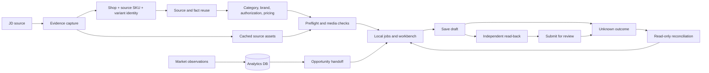

# JD → Hezi Pipeline

一个面向已登录电商后台的、可审计的商品上架流水线。它把京东商品采集、来源身份核验、目标平台类目与授权检查、图片资产处理、价格决策、草稿保存、独立读回、提交审核和未知结果对账串成一条可恢复流程。

项目包含 CLI、本地工作台、SQLite 持久化状态、Ego Browser 页面适配和自动测试。代码来源于一套真实运营流程，但本仓库只包含清理后的通用实现、合成示例和脱敏文档。

> 这不是“一键导入任意商品”的爬虫。目标平台或页面结构改变、授权缺失、来源规格冲突、图片不完整、写入结果未知时，流程会停止并留下证据。

## 能做什么

- 从京东 SKU 采集商品事实和按来源顺序排列的主图、详情图。
- 将京东来源 SKU、目标平台店铺和销售规格绑定为稳定的复合身份。
- 在目标店铺的品牌、类目和有效授权范围内准备上架计划。
- 生成并校验标题、价格、包装、规格、物流、售后及媒体映射。
- 先保存草稿，再重新打开原商品读回验证，最后提交审核。
- 使用 pending intent、幂等键和只读对账处理中断或未知写入结果。
- 将分析得到的候选商品转交到上架队列，保留来源证据和可执行性原因。
- 在本地工作台查看任务阶段、价格对比、阻塞项、耗时与远端状态。

## 不能保证什么

- 提交成功不等于审核通过，审核通过不等于在售。
- 浏览器自动化会受目标站点 UI、风控、登录状态和平台规则影响。
- 缺少商品事实时不会猜测；未覆盖的类目需要新增模板和实测。
- 当前页面适配尤其针对 `csgmall.com.cn` 供应商后台，其他平台不能仅换域名直接使用。
- 不得用本项目绕过验证码、访问限制、授权要求或平台协议。使用者和操作者负责账号、数据及发布行为。

## 架构



更完整的模块边界、数据所有权和失败状态见 [架构与流程](docs/architecture.md)。

## 快速开始

前置条件：

- Node.js 22.19 或更新版本。
- 已安装并可运行的 Ego Lite / `ego-browser`。
- 一个可登录目标供应商后台和京东的浏览器个人资料。
- 目标店铺里已存在的品牌、类目及有效授权。仓库不会替用户申请授权。

```sh
git clone https://github.com/cyl19970726/jd-hezi-pipeline.git
cd jd-hezi-pipeline
npm ci
npm run check
npm run demo
node dist/cli.js --help
```

离线 demo 不打开网站，也不创建商品。启动工作台：

```sh
npm run workbench
# 浏览器打开 http://127.0.0.1:4317
```

绑定浏览器空间与目标店铺：

```sh
# 创建新任务空间
node dist/cli.js init --profile <ego-profile-id> --shop '<店铺全名>'

# 或绑定已经存在的任务空间和页面标签
node dist/cli.js attach --space <space-id> --profile <ego-profile-id> \
  --shop '<店铺全名>' --hz p1 --jd p2

node dist/cli.js inspect
```

首次使用请只跑一个事实完整、授权明确、允许操作的 SKU，并先停在 `draft`。确认原商品读回与目标后台一致后，再按团队规则决定是否提交。

详细步骤：[快速开始与安全试运行](docs/quickstart.md) · [配置](docs/configuration.md) · [恢复](docs/recovery.md) · [扩展](docs/extending.md)。

## 核心约束

- 事实必须有来源；身份必须包含店铺、来源平台、SKU 和销售变体。
- 授权按当前店铺、品牌、类目组合核验，具有观察时间和有效期。
- 图片保留下载 URL、角色、顺序、哈希和尺寸，保存后必须读回。
- 写外部系统前持久化 pending intent；未知结果先对账，不能自动重建。
- 程序负责确定步骤；模型只在确有必要的文本歧义处理中使用，不能决定价格、授权、身份或发布状态。
- `.hezi/`、SQLite、Cookie、浏览器个人资料、订单和真实运营导出永不进入版本库。

## 仓库结构

| 路径                                   | 责任                               |
| -------------------------------------- | ---------------------------------- |
| `src/cli.ts`                           | 命令行入口                         |
| `src/engine.ts`, `src/worker.ts`       | 队列、浏览器采集和发布状态推进     |
| `src/browser/`                         | Ego 页面适配与受限 DOM 操作        |
| `src/store.ts`                         | SQLite 持久化、锁和外部写入意图    |
| `src/planner.ts`, `src/preparation.ts` | 计划、类目规则、复用与预检         |
| `src/analytics/`                       | 市场观察、机会与经营分析的只读边界 |
| `web/`, `src/server.ts`                | 仅监听本机的工作台                 |
| `test/`                                | 合成数据上的行为与恢复测试         |
| `docs/`                                | 架构、配置、操作和扩展说明         |

## 开发

```sh
npm run build
npm test
npm run demo
node scripts/check-repository-policy.mjs
npm run format:check
```

贡献说明见 [CONTRIBUTING.md](CONTRIBUTING.md)，安全问题见 [SECURITY.md](SECURITY.md)。本项目按 [MIT License](LICENSE) 发布。
