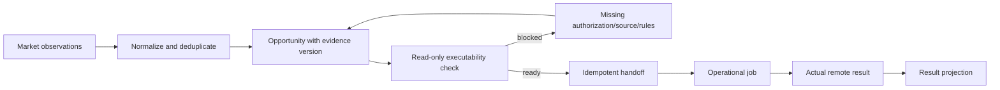

# 分析工作台

## 数据分层

| 层         | 例子                                           | 可回答的问题           |
| ---------- | ---------------------------------------------- | ---------------------- |
| 原始观察   | 商品链接、店铺、观测时间、页面标签             | 当时看到什么？         |
| 规范化事实 | 精确 SKU、销售规格、价格口径、类目、品牌、授权 | 这条证据属于哪个商品？ |
| 候选与决策 | 机会、可执行性、缺项、人工判断                 | 为什么进入或退出待办？ |
| 结果投影   | 任务、远端商品、审核或在售状态、订单指标       | 实际发生了什么？       |

缺失值不补零；累计展示指数、销量、订单金额和预测不能混成一个“总销量”。

## 从研究到执行

“可执行性”必须组合当前目录、授权、来源身份、重复扫描覆盖和准备结果。分析页面的提示本身不构成发布许可。

## 指标解释

- **搜索或销量指数**：只表示平台给出的相对信号，不能直接换算成金额。
- **订单金额**：来自真实订单导入，按明确时间窗口和状态计算。
- **评价或更新时间**：只能作为辅助信号，不能代表交易发生时间。
- **预测**：必须与已发生指标分开显示，并注明模型假设。

## 隐私

订单、客户、真实店铺报告和私有研究永不提交。公开仓库只保留 schema、算法和合成 fixture。
