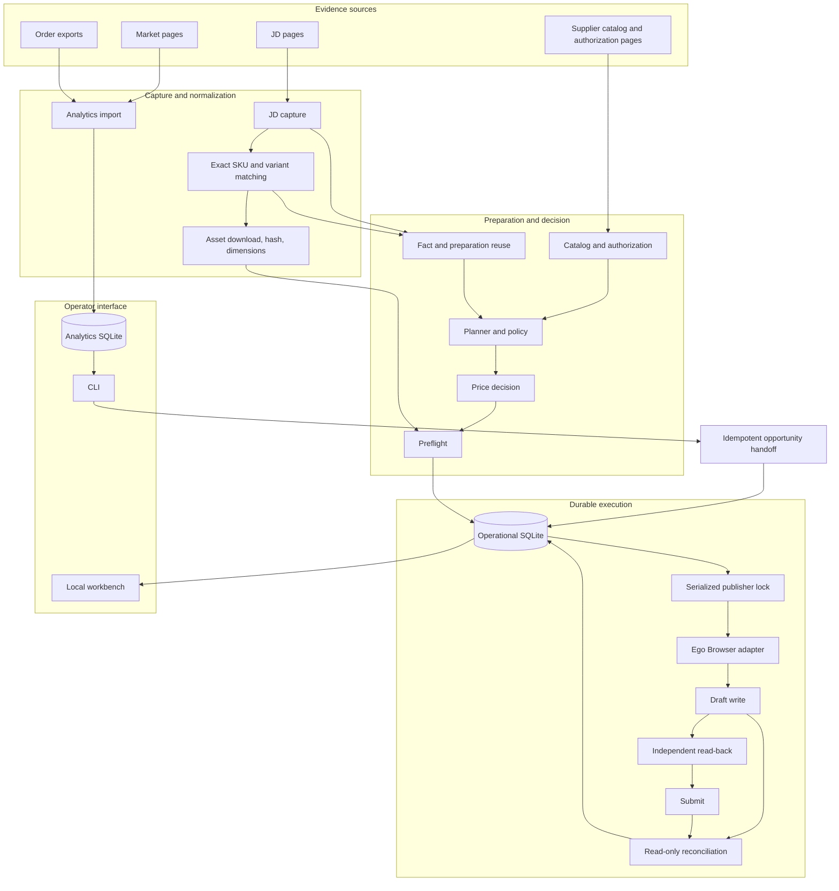
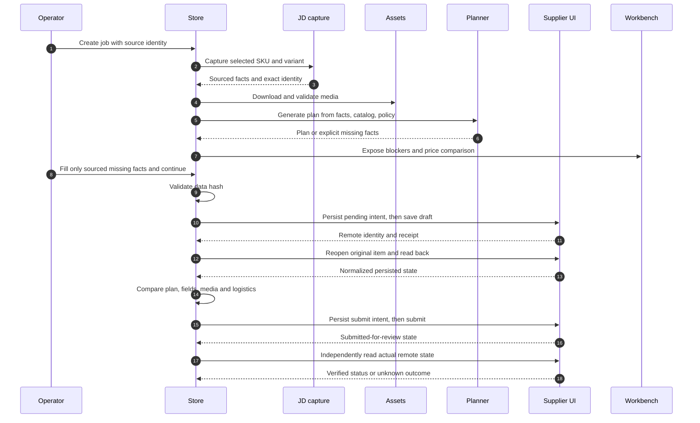
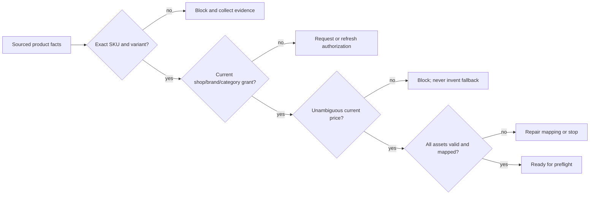
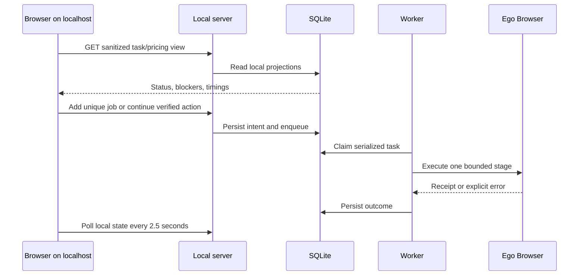

# 架构与流程

本文描述公开仓库当前实现的结构。站点页面会变化，因此“模块已存在”不等于“所有类目已适配”；真实发布前必须按当前页面和店铺授权重新验收。

## 设计目标

系统把四类风险分开处理：

1. **来源风险**：采集到的商品、规格、价格和图片是否确实属于同一个京东 SKU。
2. **业务风险**：当前店铺、品牌和类目是否已有有效授权，计划是否符合平台必填规则。
3. **写入风险**：外部保存或提交是否成功，是否有重复、超时或结果未知。
4. **经营风险**：分析候选、申请授权和上架执行是否被混为一谈。

确定性步骤由程序执行。浏览器自动化只操作已观察页面，不绕过验证码或平台限制。文本模型不是发布授权来源。

## 总览



## 模块边界

| 模块                                                   | 当前职责                                 | 不应越过的边界                                  |
| ------------------------------------------------------ | ---------------------------------------- | ----------------------------------------------- |
| `src/browser/`                                         | 页面识别、DOM 读取、表单填写、上传与回执 | 不另开第二个浏览器，不保存 Cookie，不猜页面结构 |
| `src/jd-capture.ts`, `src/opportunity-source-match.ts` | 京东事实与精确 SKU/规格证据              | 不把标题相似当成同款                            |
| `src/assets.ts`                                        | 下载、缓存、解码、尺寸和哈希             | 不把截图当商品素材                              |
| `src/catalog.ts`                                       | 店铺品牌、类目、授权和覆盖范围           | 不以品牌名称替代当前授权                        |
| `src/planner.ts`, `src/preparation.ts`                 | 根据来源事实和店铺规则生成计划           | 不从不可靠字段补造型号、容量、数量或价格        |
| `src/store.ts`                                         | SQLite 状态、身份、回执、锁与镜像文件    | 不删除旧记录来伪装恢复                          |
| `src/engine.ts`, `src/worker.ts`                       | 串行推进采集、保存、读回、提交与恢复     | 不给未知写入自动重放                            |
| `src/analytics/`                                       | 市场观察、候选、订单指标和机会交接       | 不直接修改发布状态                              |
| `src/server.ts`, `web/`                                | 本地工作台与只读查询                     | 不轮询外部站点，不暴露 Cookie                   |
| `src/reconcile.ts`                                     | 只读远端对账                             | 不以“没找到”推定写入失败                        |

## 双数据库

- `state.sqlite` 是运营事实：来源、目录、授权、商品计划、任务、外部写入意图、平台回执和媒体关系。
- `analytics.sqlite` 是分析事实：商城观察、候选、授权申请线索、订单与经营指标。
- 分析库可以通过幂等 handoff 创建或复用一个运营任务；分析模块不能直接写发布状态。
- 两个数据库不宣称分布式原子事务。响应丢失时按同一意图键查询；找到同一任务就复用，找不到也不能盲目重放平台写入。

## 单品执行流程



真正的提交入口只能在实际验证通过后开放。`DONE`、`SUBMITTED` 和 `ON_SALE` 是三种不同状态。

## 身份与幂等

商品身份至少包括：

```text
(shop, source_platform, source_sku, source_variant)
```

平台商品编号、店铺内部编号和品牌 ID 是独立字段。写入前把意图持久化；成功后记录平台身份和回执。重跑时：

- 已有确定绑定：读取原商品，不新建。
- 存在 pending 或未知结果：只读对账，不重放。
- 远端恰好一个稳定匹配：恢复原绑定。
- 不存在、多个匹配或扫描不完整：继续保持阻断。

## 价格、授权和媒体



授权、价格和页面事实都有观察时间。缓存命中只表示已有证据，是否可复用取决于具体字段、来源上下文、规则版本和过期策略。

## 工作台连接



工作台只监听 `127.0.0.1`，校验 Host、Origin 和本机会话令牌。页面轮询本地数据库，不会让两站自动增加请求。

## 失败恢复

```stateDiagram-v2
  [*] --> QUEUED
  QUEUED --> PREPARING
  PREPARING --> NEEDS_INPUT: missing fact or rules
  PREPARING --> READY: valid current plan
  READY --> WRITING: pending saved
  WRITING --> DRAFTED: save receipt
  WRITING --> UNKNOWN_OUTCOME: timeout or lost receipt
  DRAFTED --> VERIFIED: read-back matches
  VERIFIED --> SUBMITTED: submit receipt
  SUBMITTED --> UNKNOWN_OUTCOME: outcome not observed
  UNKNOWN_OUTCOME --> DRAFTED: reconcile finds draft
  UNKNOWN_OUTCOME --> SUBMITTED: reconcile finds submitted
  NEEDS_INPUT --> PREPARING: sourced correction added
  DRAFTED --> NEEDS_INPUT: read-back mismatch
  SUBMITTED --> ON_SALE: later audit observes sale
```

`UNKNOWN_OUTCOME` 不允许自动转成可重试。先执行原身份只读对账；真实状态明确后再恢复。

## 当前边界

- 页面适配以当前供应商后台为主，跨平台需要新增适配层和回归测试。
- 已实现统一可执行性判断、来源复用、机会转任务、价格核验、草稿读回和未知结果对账。
- 更多类目模板、订单完整回流、替代选品闭环和长期无人值守仍需逐项真实验收。
- 并发写入采用单状态库串行锁；未实现多机分布式锁。
- 自动测试用合成数据验证行为，不能替代目标店铺的一次受控试运行。
