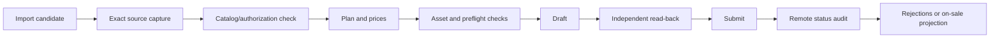

# 操作手册

## 日常流程



## 批量任务

- 先让同一类目、同一授权、同一模板的商品完成准备，再进入队列。
- `shop + source SKU + variant` 是去重键；同一 SKU 的不同销售规格不能合并。
- 未知结果、错 SKU 和缺事实商品应退出主队列，单独处理。
- 批次结果按 SKU 统计，不把一次成功执行或重复读回算作多件新增。
- 平台级登录或风控可以暂停整队；单个商品缺字段不应阻塞其他商品。

## 分析到上架

分析库、商城观察和机会队列通过本地工作台与分析模块读取。任何候选进入上架任务后，仍须重新通过实时来源、授权、类目、价格和重复检查。公开版不附带真实商城或订单数据，也不声称未导入的数据可以自动推导销量。

## 对账

```sh
node dist/cli.js --dir "$HEZI_DIR" audit-known
node dist/cli.js --dir "$HEZI_DIR" reconcile '<record-id>'
node dist/cli.js --dir "$HEZI_DIR" events
```

只读对账不得触发提交、删除或自动调价。对账覆盖范围必须与结果一起记录。

## 运营日志

- 保留每个任务的外部写入回执和时间。
- 失败阶段、完整错误和恢复动作应可追踪。
- 不把页面加载提示当成业务错误，也不把业务错误埋在加载等待中。
- 远端状态以实际读回为准；本地任务完成不是商品成功。
