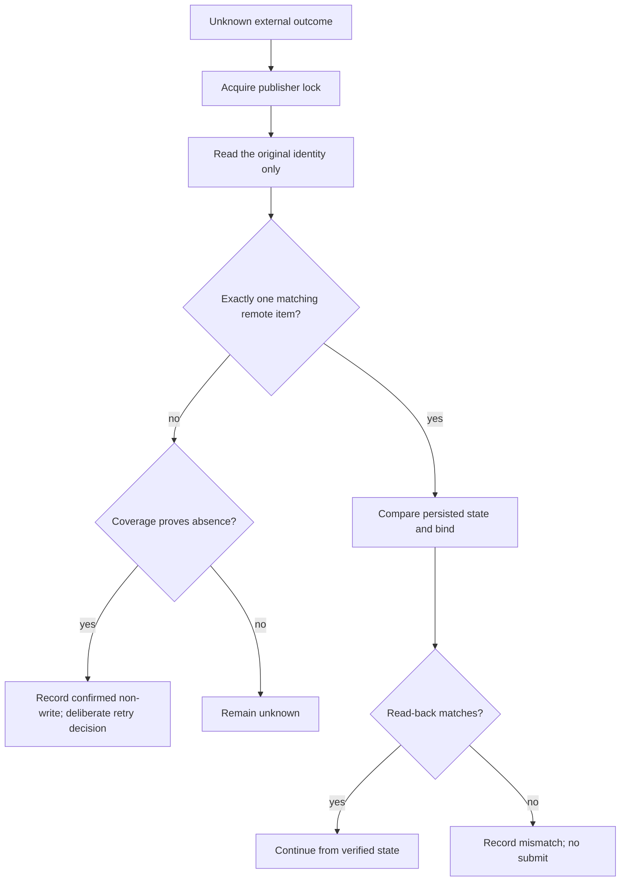

# 失败分类与恢复

恢复的核心原则是：先判断外部系统到底发生了什么，再决定是否继续。不要通过删除数据库、改终态或换一个相似标题绕过检查。

## 状态处理

| 状态               | 含义                         | 下一步                                 |
| ------------------ | ---------------------------- | -------------------------------------- |
| `AUTH_REQUIRED`    | 登录或会话失效               | 操作者完成登录，重新检查页面与店铺身份 |
| `CONTROL_REQUIRED` | 浏览器控制权在用户或权限弹窗 | 处理当前提示，交回同一任务空间         |
| `RATE_LIMITED`     | 平台明确限流                 | 停止访问，遵守等待要求，不自动重放     |
| `BUSINESS_BLOCKED` | 当前商品或授权不满足平台规则 | 只处理该商品，读取完整真实原因         |
| `NEEDS_INPUT`      | 缺事实、规则或媒体映射       | 补有来源的缺项，重新准备并校验         |
| `UNKNOWN_OUTCOME`  | 写请求可能已生效但回执丢失   | 禁止重放，执行原身份只读对账           |

## 未知写入



“没搜到”只有在搜索覆盖完整、身份解析明确且分页全部完成时才算证明。单页结果、模糊标题和扫描超时都不够。

## 锁

```sh
node dist/cli.js --dir "$HEZI_DIR" recover-locks
```

该命令只回收已退出进程持有的锁，不代表外部写入已恢复。先恢复锁，再对账原商品。

## 审核驳回

驳回是商品状态，不是整批失败。处理方式：

1. 读取完整的平台驳回原因，而不只是列表上的通用标签。
2. 在平台允许编辑时，用原远端 ID 修订。
3. 保留已经核验的价格、媒体和物流，只修改有证据的字段。
4. 独立读回后重新提交。
5. 如果平台不允许在原记录修订，按页面能力决定撤回或受控替代；旧记录与新旧身份关系必须持久化。

不要用“重新创建一个相似商品”代替正常的编辑流程。

## 崩溃与备份

- 进程崩溃后先检查是否有 running job、pending intent 或未知外部结果。
- 备份状态时包含 SQLite、WAL/SHM 和已下载资产；优先使用项目提供的快照命令。
- 代码回滚不会回滚外部平台商品。外部事实需要显式对账或受控迁移。
- 不删除历史任务来换取“看起来干净”的状态。
